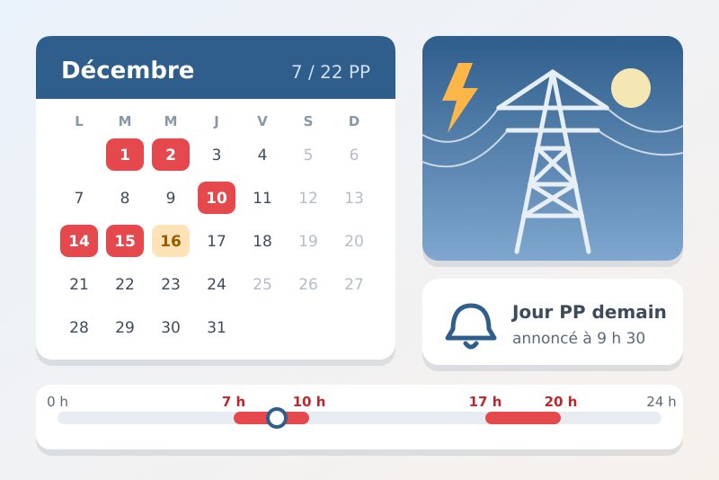
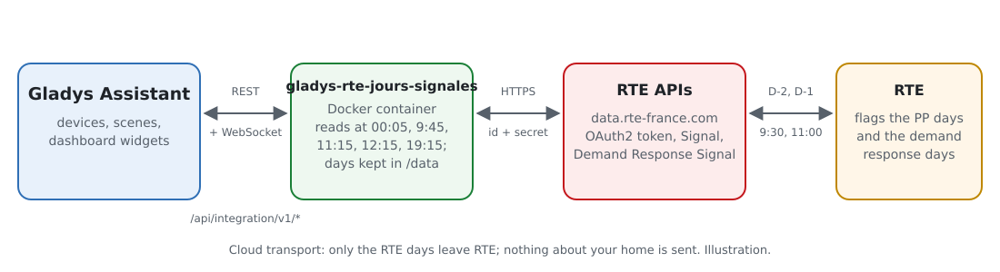
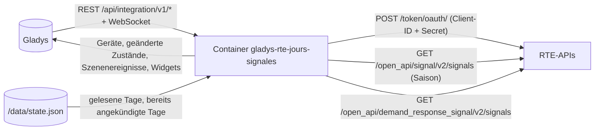
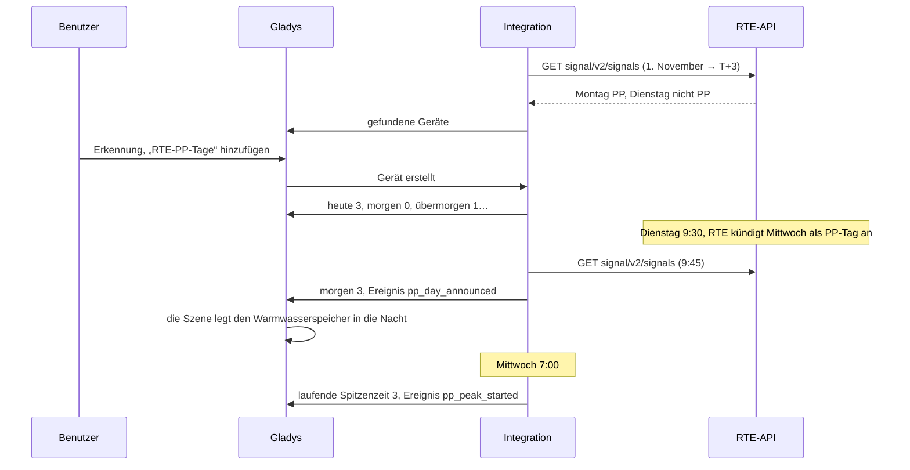
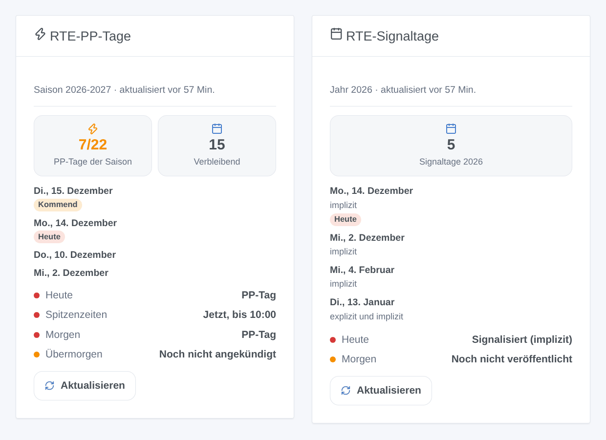

# Gladys RTE Jours signalés

[English](README.md) · [Français](README.fr.md) · **Deutsch** · [Español](README.es.md)

[](LICENSE)
[](https://github.com/William-De71/gladys-rte-jours-signales/releases)
[](https://github.com/William-De71/gladys-rte-jours-signales/actions/workflows/release.yml)
[](https://gladysassistant.com)



Externe Integration für [Gladys Assistant](https://gladysassistant.com) für die Tage, die **RTE** im französischen Stromnetz signalisiert: die **PP-Tage** des neuen Kapazitätsmechanismus (ab 1. November 2026) und die **Lastabwurftage** der Lastabwurf-Ausschreibung. Sie liest die offiziellen RTE-APIs ([data.rte-france.com](https://data.rte-france.com)) mit deiner eigenen, kostenlosen Anwendung und ergänzt Szenenauslöser und zwei Widgets, um den Verbrauch zur richtigen Zeit zu verschieben.

Benutzerdokumentation: [English](docs/en.md) · [Français](docs/fr.md) · [Deutsch](docs/de.md) · [Español](docs/es.md).

Nicht mit RTE verbunden. **Noch nicht mit einer echten RTE-Anwendung getestet**: Die Anfragen folgen den offiziellen Benutzerhandbüchern der APIs „Signal“ 2.0 und „Demand Response Signal“ 2.0.

## Funktionen

- **PP-Tage** (Kapazitätsmechanismus, 1. November bis 31. März): heute, morgen und übermorgen (normaler Tag, noch nicht angekündigt, PP-Tag), **laufende Spitzenzeit** (7-10 Uhr und 17-20 Uhr eines PP-Tags), PP-Tage der Saison und verbleibende von 22.
- **Lastabwurftage**: heute und morgen (signalisiert, nicht signalisiert, noch nicht veröffentlicht), Signaltage des Jahres mit ihrer Art (explizit, implizit).
- Abfragen zu den Veröffentlichungszeiten von RTE (00:05, 09:45, 12:15, 19:15 für die PP-Tage; 00:05 und 11:15 für den Lastabwurf), danach alle 30 Minuten, solange morgen unbekannt ist: wenige Anfragen am Tag.
- **4 Szenenauslöser** und **2 Dashboard-Widgets** (unten), eine Schaltfläche **Verbindung testen**.
- Eine Anwendung mit nur einer der beiden APIs genügt: Die Integration bietet das Gerät jeder API an, die antwortet.
- Vier Sprachen überall: Englisch, Französisch, Deutsch, Spanisch.

## Funktionsweise





Von einer RTE-Ankündigung zur Szene:



### Transport

`transports: ["cloud"]`: Die Integration liest nur die RTE-APIs über HTTPS mit deiner Client-ID und deinem Secret. Nichts über dein Zuhause verlässt Gladys. Die Tage werden immer in französischer Zeit gezählt, unabhängig von der Zeitzone von Gladys.

## Geräte und Funktionen

**RTE-PP-Tage**:

| Funktion              | Kategorie / Typ              | Werte                                                     |
| --------------------- | ---------------------------- | --------------------------------------------------------- |
| PP-Tag heute          | `risk` / `integer`           | 0 normaler Tag, 1 noch nicht angekündigt, 3 PP-Tag        |
| PP-Tag morgen         | `risk` / `integer`           | ebenso                                                    |
| PP-Tag übermorgen     | `risk` / `integer`           | ebenso (RTE kann ab T-2 ankündigen)                       |
| Spitzenzeit läuft     | `risk` / `integer`           | 3 zwischen 7-10 Uhr oder 17-20 Uhr eines PP-Tags, sonst 0 |
| PP-Tage dieser Saison | `counter-sensor` / `integer` | 0 bis 22                                                  |
| Verbleibende PP-Tage  | `counter-sensor` / `integer` | 22 minus die PP-Tage der Saison                           |

**RTE-Lastabwurftage**:

| Funktion                 | Kategorie / Typ              | Werte                                                             |
| ------------------------ | ---------------------------- | ----------------------------------------------------------------- |
| Signaltag heute          | `risk` / `integer`           | 0 nicht signalisiert, 1 noch nicht veröffentlicht, 3 signalisiert |
| Signaltag morgen         | `risk` / `integer`           | ebenso                                                            |
| Signaltage dieses Jahres | `counter-sensor` / `integer` | 0 bis 366                                                         |

Die Kategorie `risk` ist die des EcoWatt-Signals in Gladys: grünes Abzeichen „Kein Risiko“ (0), gelb „Niedrig“ (1, noch nicht bekannt), rot „Hoch“ (3). „Noch nicht angekündigt“ gilt nur für einen Werktag der Saison (kein Wochenende, kein Feiertag), solange PP-Tage übrig sind.

## Auslöser, Szenenaktionen und Widgets



Widgets:

- **RTE-PP-Tage**: heute, morgen, übermorgen, Spitzenzeiten eines PP-Tags, PP-Tage der Saison von 22 und verbleibende, die letzten PP-Tage, **Aktualisieren**.
- **RTE-Signaltage**: heute und morgen (mit der Art explizit / implizit), Signaltage des Jahres und die letzten, **Aktualisieren**.

Szenenauslöser: ein PP-Tag wird angekündigt (Filter heute / morgen / übermorgen), eine Spitzenzeit beginnt, eine Spitzenzeit endet (Filter Morgen / Abend), ein Lastabwurftag wird signalisiert (Filter Tag und Art). Jeder Tag löst nur einmal aus, auch nach einem Neustart.

Keine Szenenaktion: Der Zustand der Tage steht bereits in den Funktionen, als Bedingungen nutzbar, und die Integration liest RTE selbst zu den Veröffentlichungszeiten.

Beispiele:

- Wenn ein PP-Tag für morgen angekündigt wird → benachrichtigen „Morgen PP-Tag: Heizung 7-10 Uhr und 17-20 Uhr abgesenkt“.
- Wenn eine Spitzenzeit beginnt → Heizkörper um 2 °C absenken und den Warmwasserspeicher ausschalten; wenn sie endet → alles zurücksetzen.
- Wenn ein impliziter Lastabwurftag signalisiert wird → das Laden des Autos nach 20 Uhr verschieben.

## Voraussetzungen

- Gladys Assistant **5.3.0** oder neuer (ältere Instanzen können sie nicht installieren).
- Ein kostenloses Konto auf [data.rte-france.com](https://data.rte-france.com) und eine Anwendung mit der API [Signal](https://data.rte-france.com/catalog/-/api/market/Signal/v2.0) (PP-Tage), der API [Demand Response Signal](https://data.rte-france.com/catalog/-/api/market/Demand-Response-Signal/v2.0) oder beiden.

## Installation

- **Aus dem Store**: Integrationen → RTE Jours signalés → Installieren.
- **Über die Repository-URL**: Integrationen → externe Integration → `https://github.com/William-De71/gladys-rte-jours-signales`.
- **Entwicklermodus**: `npm start` mit den Variablen starten, die Gladys angibt (siehe Entwicklung).

## Konfiguration

| Feld oder Schaltfläche  | Standard    | Zweck                                                                         |
| ----------------------- | ----------- | ----------------------------------------------------------------------------- |
| Client-ID               | —           | Pflichtfeld, die Client-ID deiner RTE-Anwendung                               |
| Client-Secret           | —           | Pflichtfeld, ein Geheimnis: nie wieder angezeigt, nie in die Logs geschrieben |
| Sprache der Gerätetexte | automatisch | Namen der Geräte und Funktionen, Meldungen der Schaltfläche                   |
| Verbindung testen       | —           | Fragt jetzt beide APIs ab und zeigt die Antwort jeder, heute und morgen       |

## Verwendung

1. Abonniere auf data.rte-france.com für eine Anwendung die APIs „Signal“ und „Demand Response Signal“ und kopier ihre Client-ID und ihr Secret in die Konfiguration der Integration.
2. Klick auf **Verbindung testen**.
3. **Erkennung**, dann „RTE-PP-Tage“ und „RTE-Lastabwurftage“ als Geräte hinzufügen.
4. Die Widgets einem Dashboard hinzufügen und Szenen mit den Auslösern und Funktionen erstellen.

## Entwicklung

```bash
npm install
npm test                       # node --test, nie mit Netzwerkzugriff
npm run lint                   # ESLint
npm run format:check           # Prettier
npx github:GladysAssistant/integration-store . --skip-image-check
scripts/build-cover.sh         # cover.jpg aus docs/assets/cover.svg
docs/illustrations/render.sh   # docs/assets/widgets.<lang>.png
```

Lokal liest das SDK `GLADYS_HOST_API_URL`, `GLADYS_INTEGRATION_TOKEN` und `GLADYS_INTEGRATION_SELECTOR` (von Gladys im Entwicklermodus angegeben), und die Integration liest `TZ` (nur um die Sprache zu erraten). `DEBUG=gladys-integration-sdk` zeigt den Austausch mit Gladys.

Die Tests decken den API-Client ab (Token, Erneuerung, 401 / 403 / 404 / 429 / 400, Parameter), den französischen Kalender (Sommerzeit, Feiertage, Ostern, Saison, Spitzenzeiten), das Lesen der Antworten der RTE-Handbücher, die Stufen der Tage, die Auslöser (einmal, auch nach einem Neustart), die Abfragezeiten, die Widgets in den vier Sprachen, das Manifest und die Stabilität der IDs.

## Release-Prozess


Jeder Merge auf `main` startet die CI und berechnet dann die Version aus den [Conventional Commits](https://www.conventionalcommits.org/) seit dem letzten Tag: `feat` → Minor, `fix` / `perf` → Patch, `!` oder `BREAKING CHANGE` → Major (Minor, solange 0.x); `docs`, `chore`, `ci`, `test`, `style`, `refactor`, `build` allein veröffentlichen nichts. Der Workflow schreibt `CHANGELOG.md`, baut das Multi-Arch-Image, setzt den Tag, veröffentlicht das GitHub-Release und prüft alles.

- Der Titel des Pull Requests wird zum Squash-Commit und dann zur Changelog-Zeile: auf Englisch, für den Benutzer schreiben (`pr-title.yml` prüft ihn). `CHANGELOG.md` nie von Hand bearbeiten.
- 1.0.0 ist eine Entscheidung: Actions → Release → Run workflow mit `release-as: 1.0.0`. `dry-run` zeigt Version und Notizen, ohne etwas zu veröffentlichen.
- **Geschützter Branch**: Das Release pusht seinen Commit mit `GITHUB_TOKEN` auf `main`. Das Ruleset `protect-main` (kein Löschen, kein Force-Push) lässt ihn durch; eine strengere Regel (Pull Request oder Status Checks verpflichtend) würde ihn blockieren: dann GitHub Actions die Umgehung erlauben oder eine GitHub App verwenden.
- Nach dem ersten Release das Paket `ghcr.io` öffentlich machen (Package settings → Change visibility), sonst kann Gladys es nicht herunterladen.

## Fehlerbehebung

Siehe [docs/de.md](docs/de.md#fehlerbehebung). Melde ein Problem mit den Versionen von Gladys und der Integration, den APIs, die deine Anwendung abonniert hat, dem Ergebnis von „Verbindung testen“ und den Logs der Integration. Füge nie dein Client-Secret ein.

## Mitwirken

Issues und Pull Requests sind willkommen. Führe `npm run format:check && npm run lint && npm test` aus, bevor du einen Pull Request öffnest, und lass die externen IDs und gespeicherten Schlüssel unverändert (siehe [CLAUDE.md](CLAUDE.md)).

## Sicherheit

Siehe [SECURITY.md](SECURITY.md): Sicherheitslücken vertraulich melden. Das Client-Secret ist ein Feld vom Typ `secret`: nie in die Logs oder nach `/data` geschrieben, nur über HTTPS an `digital.iservices.rte-france.com` gesendet, um ein Token zu erhalten.

## Kommende Screenshots

Die Bilder oben sind Illustrationen, keine Screenshots. Die echten Screenshots kommen nach `docs/assets/screenshots/` (PNG, 1280 × 800): `configuration.png` (Zugangsdaten und „Verbindung testen“), `discovery.png` (beide Geräte in der Erkennung), `device.png` (die Seite des Geräts „RTE-PP-Tage“).

## Lizenz

[Apache License 2.0](LICENSE) — siehe auch [NOTICE](NOTICE). RTE ist eine Marke von RTE Réseau de transport d’électricité. Die Daten stammen aus den offiziellen RTE-APIs ([data.rte-france.com](https://data.rte-france.com)) unter deren Nutzungsbedingungen. Danke an die Dokumentation und das SDK von Gladys und an die Home-Assistant-Integration [rte-jours-signales](https://github.com/hiteule/rte-jours-signales) für die Idee.
