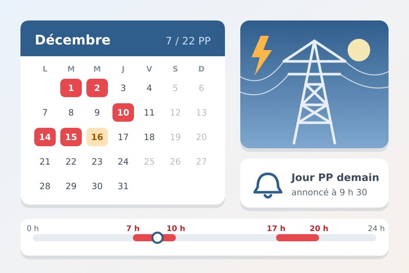
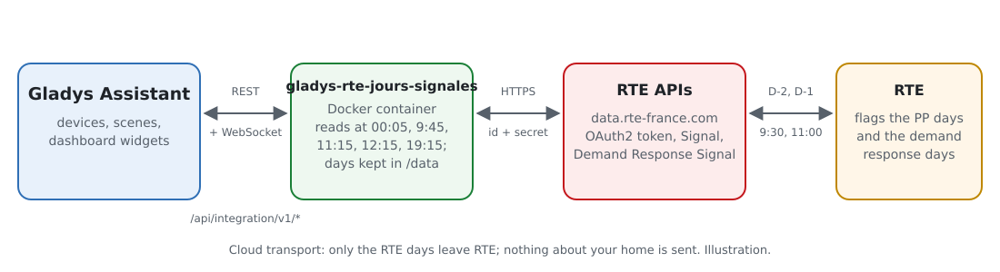
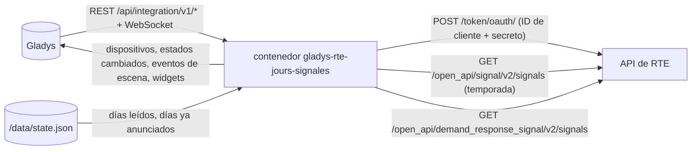
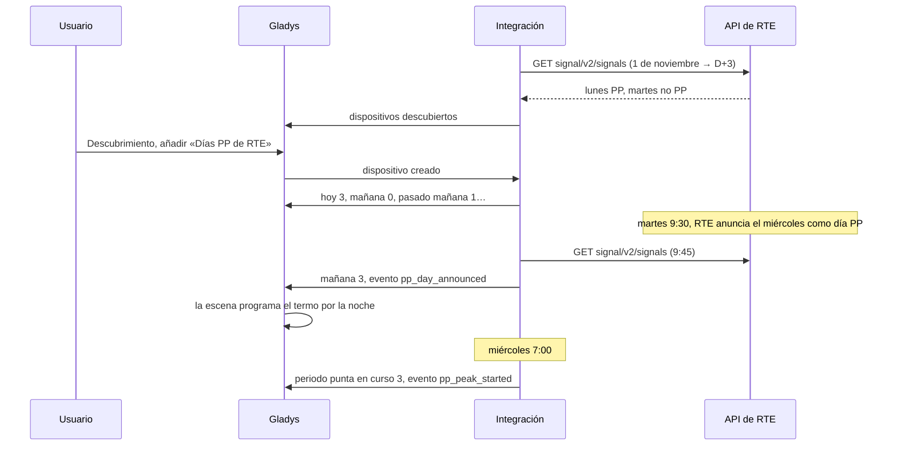
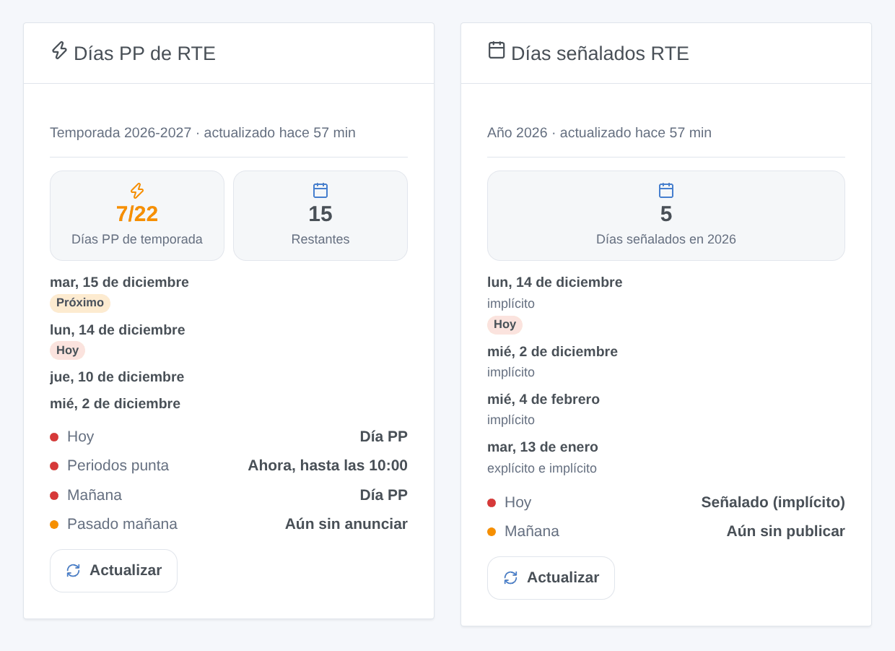

# Gladys RTE Jours signalés

[English](README.md) · [Français](README.fr.md) · [Deutsch](README.de.md) · **Español**

[](LICENSE)
[](https://github.com/William-De71/gladys-rte-jours-signales/releases)
[](https://github.com/William-De71/gladys-rte-jours-signales/actions/workflows/release.yml)
[](https://gladysassistant.com)



Integración externa de [Gladys Assistant](https://gladysassistant.com) para los días que **RTE** señala en la red eléctrica francesa: los **días PP** del nuevo mecanismo de capacidad (desde el 1 de noviembre de 2026) y los **días de deslastre** de la licitación de deslastre. Lee las API oficiales de RTE ([data.rte-france.com](https://data.rte-france.com)) con su propia aplicación gratuita, y añade desencadenantes de escena y dos widgets para desplazar el consumo en el momento adecuado.

Documentación de usuario: [English](docs/en.md) · [Français](docs/fr.md) · [Deutsch](docs/de.md) · [Español](docs/es.md).

Sin relación con RTE. **Aún no probada con una aplicación RTE real**: las peticiones siguen las guías de usuario oficiales de las API «Signal» 2.0 y «Demand Response Signal» 2.0.

## Funciones

- **Días PP** (mecanismo de capacidad, del 1 de noviembre al 31 de marzo): hoy, mañana y pasado mañana (día normal, aún sin anunciar, día PP), **periodo punta en curso** (7-10 h y 17-20 h de un día PP), días PP de la temporada y restantes de 22.
- **Días de deslastre**: hoy y mañana (señalado, no señalado, aún sin publicar), días señalados del año, con su tipo (explícito, implícito).
- Lecturas a las horas en que RTE publica (00:05, 09:45, 12:15, 19:15 para los días PP; 00:05 y 11:15 para el deslastre), y después cada 30 minutos mientras mañana sea desconocido: pocas peticiones al día.
- **4 desencadenantes de escena** y **2 widgets de panel** (abajo), un botón **Probar la conexión**.
- Basta con una aplicación suscrita a una de las dos API: la integración ofrece el dispositivo de cada API que responde.
- Cuatro idiomas en todas partes: inglés, francés, alemán, español.

## Funcionamiento





De un anuncio de RTE a una escena:



### Transporte

`transports: ["cloud"]`: la integración solo lee las API de RTE por HTTPS con su ID de cliente y su secreto. Nada sobre su casa sale de Gladys. Los días se cuentan siempre en hora francesa, sea cual sea la zona horaria de Gladys.

## Dispositivos y funciones

**Días PP de RTE**:

| Función                 | Categoría / tipo             | Valores                                        |
| ----------------------- | ---------------------------- | ---------------------------------------------- |
| Día PP hoy              | `risk` / `integer`           | 0 día normal, 1 aún sin anunciar, 3 día PP     |
| Día PP mañana           | `risk` / `integer`           | igual                                          |
| Día PP pasado mañana    | `risk` / `integer`           | igual (RTE puede anunciar desde D-2)           |
| Periodo punta en curso  | `risk` / `integer`           | 3 entre 7-10 h o 17-20 h de un día PP, si no 0 |
| Días PP de la temporada | `counter-sensor` / `integer` | 0 a 22                                         |
| Días PP restantes       | `counter-sensor` / `integer` | 22 menos los días PP de la temporada           |

**Días de deslastre de RTE**:

| Función                | Categoría / tipo             | Valores                                       |
| ---------------------- | ---------------------------- | --------------------------------------------- |
| Día señalado hoy       | `risk` / `integer`           | 0 no señalado, 1 aún sin publicar, 3 señalado |
| Día señalado mañana    | `risk` / `integer`           | igual                                         |
| Días señalados del año | `counter-sensor` / `integer` | 0 a 366                                       |

La categoría `risk` es la de la señal EcoWatt en Gladys: insignia verde «Sin riesgo» (0), amarilla «Bajo» (1, aún desconocido), roja «Alto» (3). «Aún sin anunciar» solo vale para un día laborable de la temporada (ni fin de semana ni festivo) mientras queden días PP.

## Desencadenantes, acciones de escena y widgets



Widgets:

- **Días PP de RTE**: hoy, mañana, pasado mañana, periodos punta de un día PP, días PP de la temporada de 22 y restantes, los últimos días PP, **Actualizar**.
- **Días señalados RTE**: hoy y mañana (con el tipo explícito / implícito), días señalados del año y los últimos, **Actualizar**.

Desencadenantes de escena: se anuncia un día PP (filtro hoy / mañana / pasado mañana), empieza un periodo punta, termina un periodo punta (filtro mañana / tarde), se señala un día de deslastre (filtros día y tipo). Cada día se desencadena una sola vez, incluso tras un reinicio.

Sin acción de escena: el estado de los días ya está en las funciones, utilizables como condiciones, y la integración lee RTE sola a las horas de publicación.

Ejemplos:

- Cuando se anuncia un día PP para mañana → notificar «Mañana día PP: calefacción reducida de 7 a 10 h y de 17 a 20 h».
- Cuando empieza un periodo punta → bajar los radiadores 2 °C y apagar el termo; cuando termina → restablecerlo todo.
- Cuando se señala un día de deslastre implícito → retrasar la carga del coche después de las 20 h.

## Requisitos

- Gladys Assistant **5.3.0** o posterior (las instancias más antiguas no pueden instalarla).
- Una cuenta gratuita en [data.rte-france.com](https://data.rte-france.com) y una aplicación suscrita a la API [Signal](https://data.rte-france.com/catalog/-/api/market/Signal/v2.0) (días PP), a la API [Demand Response Signal](https://data.rte-france.com/catalog/-/api/market/Demand-Response-Signal/v2.0), o a ambas.

## Instalación

- **Desde la tienda**: Integraciones → RTE Jours signalés → Instalar.
- **Desde la URL del repositorio**: Integraciones → integración externa → `https://github.com/William-De71/gladys-rte-jours-signales`.
- **Modo desarrollador**: ejecute `npm start` con las variables que da Gladys (ver Desarrollo).

## Configuración

| Campo o botón                            | Por defecto | Función                                                                           |
| ---------------------------------------- | ----------- | --------------------------------------------------------------------------------- |
| ID de cliente                            | —           | Obligatorio, el ID de cliente de su aplicación RTE                                |
| Secreto de cliente                       | —           | Obligatorio, un secreto: nunca se vuelve a mostrar ni se escribe en los registros |
| Idioma de los textos de los dispositivos | automático  | Nombres de los dispositivos y funciones, mensajes del botón                       |
| Probar la conexión                       | —           | Lee ahora las dos API e indica la respuesta de cada una, hoy y mañana             |

## Uso

1. En data.rte-france.com, suscriba una misma aplicación a las API «Signal» y «Demand Response Signal», y copie su ID de cliente y su secreto en la configuración de la integración.
2. Haga clic en **Probar la conexión**.
3. **Descubrimiento**, y añada «Días PP de RTE» y «Días de deslastre de RTE» como dispositivos.
4. Añada los widgets a un panel y cree escenas con los desencadenantes y las funciones.

## Desarrollo

```bash
npm install
npm test                       # node --test, nunca toca la red
npm run lint                   # ESLint
npm run format:check           # Prettier
npx github:GladysAssistant/integration-store . --skip-image-check
scripts/build-cover.sh         # cover.jpg desde docs/assets/cover.svg
docs/illustrations/render.sh   # docs/assets/widgets.<lang>.png
```

En local, el SDK lee `GLADYS_HOST_API_URL`, `GLADYS_INTEGRATION_TOKEN` y `GLADYS_INTEGRATION_SELECTOR` (dados por Gladys en modo desarrollador), y la integración lee `TZ` (solo para adivinar el idioma). `DEBUG=gladys-integration-sdk` muestra los intercambios con Gladys.

Las pruebas cubren el cliente de las API (token, renovación, 401 / 403 / 404 / 429 / 400, parámetros), el calendario francés (horario de verano, festivos, Pascua, temporada, periodos punta), la lectura de las respuestas de las guías de RTE, los niveles de los días, los desencadenantes (una sola vez, incluso tras un reinicio), los horarios de lectura, los widgets en los cuatro idiomas, el manifiesto y la estabilidad de los identificadores.

## Proceso de release


Cada fusión en `main` lanza la CI y calcula la versión a partir de los [Conventional Commits](https://www.conventionalcommits.org/) desde la última etiqueta: `feat` → menor, `fix` / `perf` → parche, `!` o `BREAKING CHANGE` → mayor (menor mientras sea 0.x); `docs`, `chore`, `ci`, `test`, `style`, `refactor`, `build` solos no publican nada. El workflow escribe `CHANGELOG.md`, construye la imagen multiarquitectura, pone la etiqueta, publica la GitHub Release y lo comprueba todo.

- El título de la pull request se convierte en el commit squash y luego en la línea del changelog: escríbalo en inglés, para el usuario (`pr-title.yml` lo comprueba). No edite nunca `CHANGELOG.md` a mano.
- La 1.0.0 es una decisión: Actions → Release → Run workflow con `release-as: 1.0.0`. `dry-run` muestra la versión y las notas sin publicar nada.
- **Rama protegida**: la release empuja su commit a `main` con `GITHUB_TOKEN`. El ruleset `protect-main` (ni borrado ni force-push) lo deja pasar; una regla más estricta (pull request o status checks obligatorios) lo bloquearía: permita entonces que GitHub Actions la omita, o use una GitHub App.
- Tras la primera release, haga público el paquete `ghcr.io` (Package settings → Change visibility), o Gladys no podrá descargarlo.

## Solución de problemas

Ver [docs/es.md](docs/es.md#solución-de-problemas). Informe de un problema con las versiones de Gladys y de la integración, las API a las que está suscrita su aplicación, el resultado de «Probar la conexión» y los registros de la integración. No pegue nunca su secreto.

## Contribuir

Issues y pull requests son bienvenidas. Ejecute `npm run format:check && npm run lint && npm test` antes de abrir una pull request, y mantenga sin cambios los identificadores externos y las claves almacenadas (ver [CLAUDE.md](CLAUDE.md)).

## Seguridad

Ver [SECURITY.md](SECURITY.md): informe de las vulnerabilidades en privado. El secreto es un campo `secret`: nunca se escribe en los registros ni en `/data`, solo se envía a `digital.iservices.rte-france.com` por HTTPS para obtener un token.

## Capturas por venir

Las imágenes de arriba son ilustraciones, no capturas de pantalla. Las capturas reales irán a `docs/assets/screenshots/` (PNG, 1280 × 800): `configuration.png` (credenciales y «Probar la conexión»), `discovery.png` (los dos dispositivos en el Descubrimiento), `device.png` (la página del dispositivo «Días PP de RTE»).

## Licencia

[Apache License 2.0](LICENSE) — ver también [NOTICE](NOTICE). RTE es una marca de RTE Réseau de transport d’électricité. Los datos proceden de las API oficiales de RTE ([data.rte-france.com](https://data.rte-france.com)), según sus condiciones de uso. Gracias a la documentación y al SDK de Gladys, y a la integración de Home Assistant [rte-jours-signales](https://github.com/hiteule/rte-jours-signales) por la idea.
