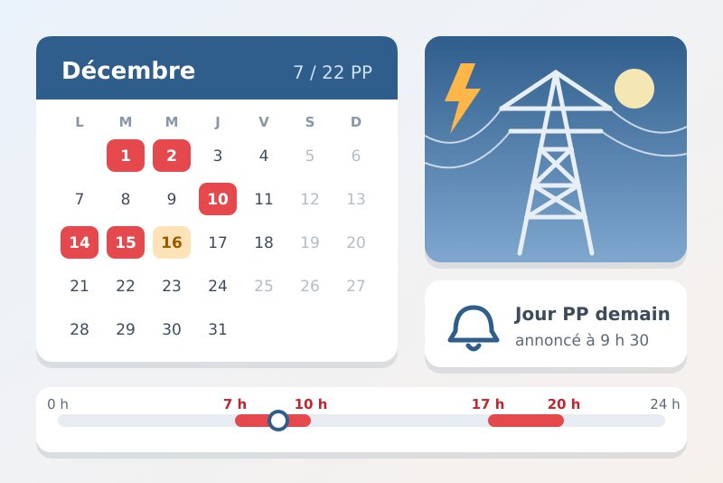
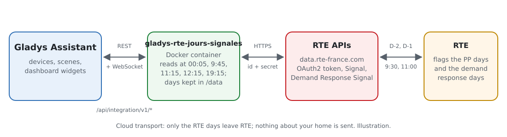
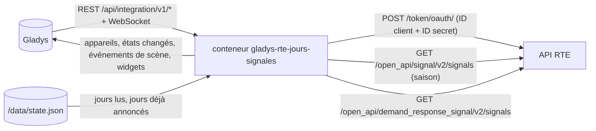
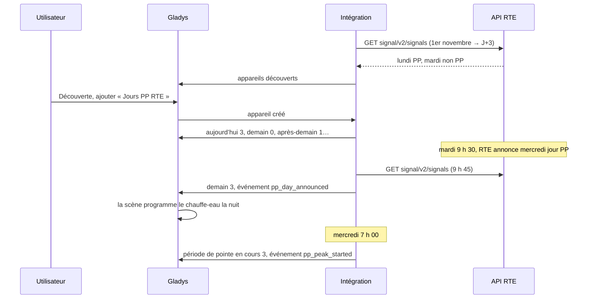
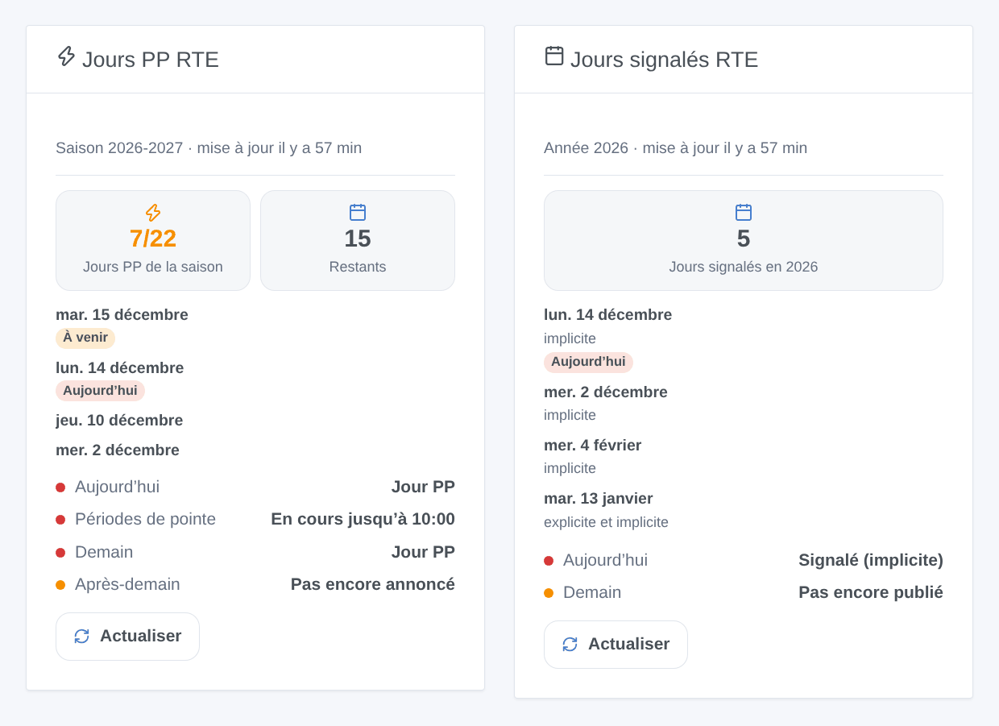

# Gladys RTE Jours signalés

[English](README.md) · **Français** · [Deutsch](README.de.md) · [Español](README.es.md)

[](LICENSE)
[](https://github.com/William-De71/gladys-rte-jours-signales/releases)
[](https://github.com/William-De71/gladys-rte-jours-signales/actions/workflows/release.yml)
[](https://gladysassistant.com)



Intégration externe de [Gladys Assistant](https://gladysassistant.com) pour les jours que **RTE** signale sur le réseau électrique français : les **jours PP** du nouveau mécanisme de capacité (à partir du 1er novembre 2026) et les **jours signalés effacement** de l’appel d’offres effacement. Elle lit les API officielles de RTE ([data.rte-france.com](https://data.rte-france.com)) avec votre propre application, gratuite, et ajoute des déclencheurs de scène et deux widgets pour décaler sa consommation au bon moment.

Documentation utilisateur : [English](docs/en.md) · [Français](docs/fr.md) · [Deutsch](docs/de.md) · [Español](docs/es.md).

Non affiliée à RTE. **Pas encore testée avec une vraie application RTE** : les requêtes suivent les guides d’utilisation officiels des API « Signal » 2.0 et « Demand Response Signal » 2.0.

## Fonctionnalités

- **Jours PP** (mécanisme de capacité, du 1er novembre au 31 mars) : aujourd’hui, demain et après-demain (jour normal, pas encore annoncé, jour PP), **période de pointe en cours** (7 h-10 h et 17 h-20 h d’un jour PP), jours PP de la saison et restants sur 22.
- **Jours signalés effacement** : aujourd’hui et demain (signalé, non signalé, pas encore publié), jours signalés de l’année, avec leur type (explicite, implicite).
- Lectures aux heures où RTE publie (00 h 05, 9 h 45, 12 h 15, 19 h 15 pour les jours PP ; 00 h 05 et 11 h 15 pour l’effacement), puis toutes les 30 minutes tant que demain reste inconnu : quelques requêtes par jour.
- **4 déclencheurs de scène** et **2 widgets de tableau de bord** (ci-dessous), un bouton **Tester la connexion**.
- Une application abonnée à une seule des deux API suffit : l’intégration propose l’appareil de chaque API qui répond.
- Quatre langues partout : anglais, français, allemand, espagnol.

## Fonctionnement





D’une annonce RTE à une scène :



### Transport

`transports: ["cloud"]` : l’intégration ne fait que lire les API RTE en HTTPS avec votre ID client et votre ID secret. Rien sur votre maison ne quitte Gladys. Les jours sont toujours comptés en heure française, quel que soit le fuseau de Gladys.

## Appareils et fonctionnalités

**Jours PP RTE** :

| Fonctionnalité             | Catégorie / type             | Valeurs                                                   |
| -------------------------- | ---------------------------- | --------------------------------------------------------- |
| Jour PP aujourd’hui        | `risk` / `integer`           | 0 jour normal, 1 pas encore annoncé, 3 jour PP            |
| Jour PP demain             | `risk` / `integer`           | idem                                                      |
| Jour PP après-demain       | `risk` / `integer`           | idem (RTE peut annoncer dès J-2)                          |
| Période de pointe en cours | `risk` / `integer`           | 3 entre 7 h et 10 h ou 17 h et 20 h d’un jour PP, sinon 0 |
| Jours PP de la saison      | `counter-sensor` / `integer` | 0 à 22                                                    |
| Jours PP restants          | `counter-sensor` / `integer` | 22 moins les jours PP de la saison                        |

**Jours signalés effacement RTE** :

| Fonctionnalité            | Catégorie / type             | Valeurs                                       |
| ------------------------- | ---------------------------- | --------------------------------------------- |
| Jour signalé aujourd’hui  | `risk` / `integer`           | 0 non signalé, 1 pas encore publié, 3 signalé |
| Jour signalé demain       | `risk` / `integer`           | idem                                          |
| Jours signalés de l’année | `counter-sensor` / `integer` | 0 à 366                                       |

La catégorie `risk` est celle du signal EcoWatt dans Gladys : badge vert « Pas de risque » (0), jaune « Faible » (1, pas encore connu), rouge « Élevé » (3). « Pas encore annoncé » ne vaut que pour un jour ouvré de la saison (ni week-end, ni jour férié) tant qu’il reste des jours PP.

## Déclencheurs, actions de scène et widgets



Widgets :

- **Jours PP RTE** : aujourd’hui, demain, après-demain, périodes de pointe d’un jour PP, jours PP de la saison sur 22 et restants, les derniers jours PP, **Actualiser**.
- **Jours signalés RTE** : aujourd’hui et demain (avec le type explicite / implicite), jours signalés de l’année et les derniers, **Actualiser**.

Déclencheurs de scène : un jour PP est annoncé (filtre aujourd’hui / demain / après-demain), une période de pointe commence, une période de pointe se termine (filtre matin / soir), un jour signalé effacement est publié (filtres jour et type). Chaque jour ne déclenche qu’une fois, même après un redémarrage.

Pas d’action de scène : l’état des jours est déjà dans les fonctionnalités, utilisables en condition, et l’intégration relit RTE seule aux heures de publication.

Exemples :

- Quand un jour PP est annoncé pour demain → notifier « Demain jour PP : chauffage réduit de 7 h à 10 h et de 17 h à 20 h ».
- Quand une période de pointe commence → baisser les radiateurs de 2 °C et couper le chauffe-eau ; quand elle se termine → tout remettre.
- Quand un jour signalé effacement (implicite) est publié → décaler la recharge de la voiture après 20 h.

## Prérequis

- Gladys Assistant **5.3.0** ou plus récent (les instances plus anciennes ne peuvent pas l’installer).
- Un compte sur [data.rte-france.com](https://data.rte-france.com) (gratuit) et une application abonnée à l’API [Signal](https://data.rte-france.com/catalog/-/api/market/Signal/v2.0) (jours PP), à l’API [Demand Response Signal](https://data.rte-france.com/catalog/-/api/market/Demand-Response-Signal/v2.0), ou aux deux.

## Installation

- **Depuis le store** : Intégrations → RTE Jours signalés → Installer.
- **Depuis l’URL du dépôt** : Intégrations → intégration externe → `https://github.com/William-De71/gladys-rte-jours-signales`.
- **Mode développeur** : lancez `npm start` avec les variables données par Gladys (voir Développement).

## Configuration

| Champ ou bouton                 | Défaut      | Rôle                                                                                |
| ------------------------------- | ----------- | ----------------------------------------------------------------------------------- |
| ID client                       | —           | Obligatoire, l’ID client de votre application RTE                                   |
| ID secret                       | —           | Obligatoire, un secret : jamais réaffiché, jamais écrit dans les journaux           |
| Langue des textes des appareils | automatique | Noms des appareils et des fonctionnalités, messages du bouton                       |
| Tester la connexion             | —           | Lit les deux API maintenant et indique la réponse de chacune, aujourd’hui et demain |

## Utilisation

1. Sur data.rte-france.com, abonnez une même application aux API « Signal » et « Demand Response Signal », puis copiez son ID client et son ID secret dans la configuration de l’intégration.
2. Cliquez sur **Tester la connexion**.
3. **Découverte**, puis ajoutez « Jours PP RTE » et « Jours signalés effacement RTE » comme appareils.
4. Ajoutez les widgets à un tableau de bord et créez des scènes avec les déclencheurs et les fonctionnalités.

## Développement

```bash
npm install
npm test                       # node --test, ne touche jamais le réseau
npm run lint                   # ESLint
npm run format:check           # Prettier
npx github:GladysAssistant/integration-store . --skip-image-check
scripts/build-cover.sh         # cover.jpg depuis docs/assets/cover.svg
docs/illustrations/render.sh   # docs/assets/widgets.<lang>.png
```

En local, le SDK lit `GLADYS_HOST_API_URL`, `GLADYS_INTEGRATION_TOKEN` et `GLADYS_INTEGRATION_SELECTOR` (donnés par Gladys en mode développeur), et l’intégration lit `TZ` (seulement pour deviner la langue). `DEBUG=gladys-integration-sdk` affiche les échanges avec Gladys.

Les tests couvrent le client des API (jeton, renouvellement, 401 / 403 / 404 / 429 / 400, paramètres), le calendrier français (heure d’été, jours fériés, Pâques, saison, périodes de pointe), la lecture des réponses des guides RTE, les niveaux des jours, les déclencheurs (une seule fois, même après redémarrage), les horaires de lecture, les widgets dans les quatre langues, le manifeste et la stabilité des identifiants.

## Processus de release


Chaque fusion sur `main` lance la CI, puis calcule la version depuis les [Conventional Commits](https://www.conventionalcommits.org/) depuis le dernier tag : `feat` → mineure, `fix` / `perf` → correctif, `!` ou `BREAKING CHANGE` → majeure (mineure tant qu’on est en 0.x) ; `docs`, `chore`, `ci`, `test`, `style`, `refactor`, `build` seuls ne publient rien. Le workflow écrit `CHANGELOG.md`, construit l’image multi-arch, pose le tag, publie la GitHub Release et vérifie le tout.

- Le titre de la pull request devient le commit squash, puis la ligne du changelog : écrivez-le en anglais, pour l’utilisateur (`pr-title.yml` le vérifie). Ne modifiez jamais `CHANGELOG.md` à la main.
- La 1.0.0 est une décision : Actions → Release → Run workflow avec `release-as: 1.0.0`. `dry-run` affiche la version et les notes sans rien publier.
- **Branche protégée** : la release pousse son commit sur `main` avec `GITHUB_TOKEN`. Le ruleset `protect-main` (ni suppression, ni force-push) le laisse passer ; une règle plus stricte (pull request obligatoire, status checks) le bloquerait : autorisez alors GitHub Actions à la contourner, ou passez par une GitHub App.
- Après la première release, rendez le package `ghcr.io` public (Package settings → Change visibility), sinon Gladys ne peut pas le télécharger.

## Dépannage

Voir [docs/fr.md](docs/fr.md#dépannage). Signalez un problème avec les versions de Gladys et de l’intégration, les API auxquelles votre application est abonnée, le résultat de « Tester la connexion » et les journaux de l’intégration. Ne collez jamais votre ID secret.

## Contribuer

Issues et pull requests sont les bienvenues. Lancez `npm run format:check && npm run lint && npm test` avant d’ouvrir une pull request, et gardez inchangés les identifiants externes et les clés stockées (voir [CLAUDE.md](CLAUDE.md)).

## Sécurité

Voir [SECURITY.md](SECURITY.md) : signalez les failles en privé. L’ID secret est un champ `secret` : jamais écrit dans les journaux ni dans `/data`, envoyé seulement à `digital.iservices.rte-france.com` en HTTPS pour obtenir un jeton.

## Captures à venir

Les images ci-dessus sont des illustrations, pas des captures d’écran. Les vraies captures iront dans `docs/assets/screenshots/` (PNG, 1280 × 800) : `configuration.png` (identifiants et « Tester la connexion »), `discovery.png` (les deux appareils dans la Découverte), `device.png` (la page de l’appareil « Jours PP RTE »).

## Licence

[Apache License 2.0](LICENSE) — voir aussi [NOTICE](NOTICE). RTE est une marque de RTE Réseau de transport d’électricité. Les données viennent des API officielles de RTE ([data.rte-france.com](https://data.rte-france.com)), sous leurs conditions d’utilisation. Merci à la documentation et au SDK de Gladys, et à l’intégration Home Assistant [rte-jours-signales](https://github.com/hiteule/rte-jours-signales) pour l’idée.
