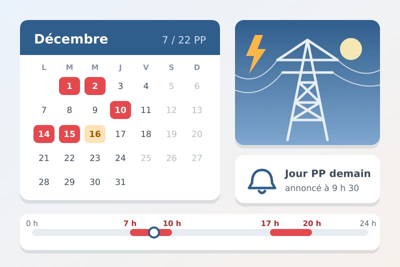
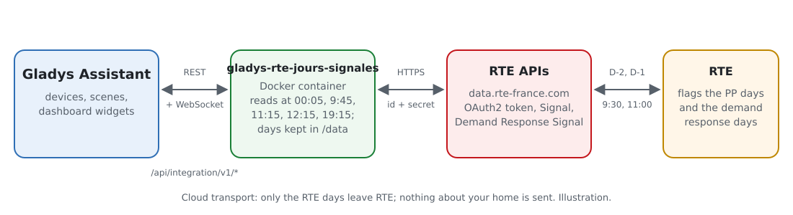
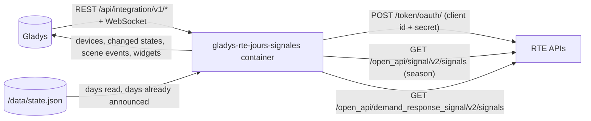
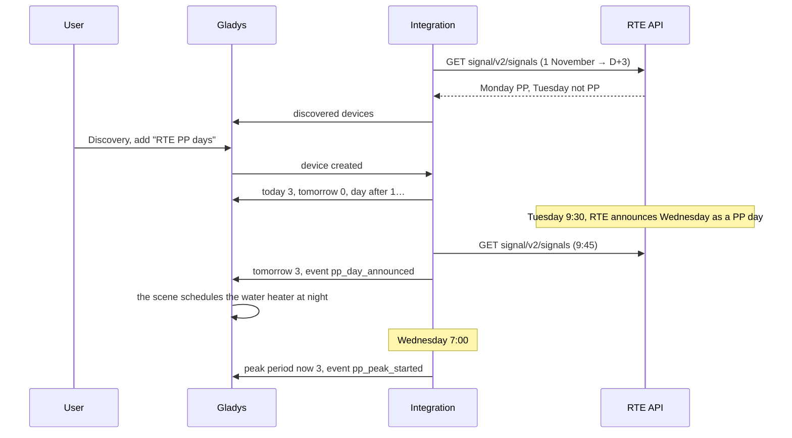
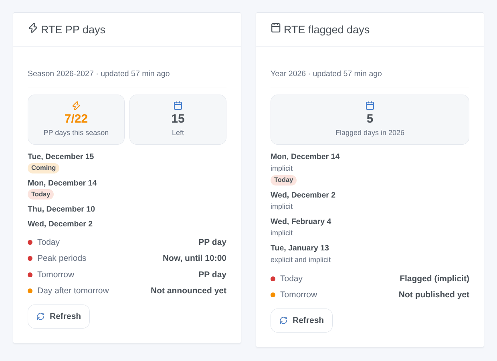

# Gladys RTE Jours signalés

**English** · [Français](README.fr.md) · [Deutsch](README.de.md) · [Español](README.es.md)

[](LICENSE)
[](https://github.com/William-De71/gladys-rte-jours-signales/releases)
[](https://github.com/William-De71/gladys-rte-jours-signales/actions/workflows/release.yml)
[](https://gladysassistant.com)



External [Gladys Assistant](https://gladysassistant.com) integration for the days **RTE** flags on the French power grid: the **PP days** of the new capacity mechanism (from 1 November 2026) and the **demand response days** of the demand response tender. It reads the official RTE APIs ([data.rte-france.com](https://data.rte-france.com)) with your own free application, and adds scene triggers and two widgets to shift your consumption at the right time.

User documentation: [English](docs/en.md) · [Français](docs/fr.md) · [Deutsch](docs/de.md) · [Español](docs/es.md).

Not affiliated with RTE. **Not tested with a real RTE application yet**: the requests follow the official user guides of the "Signal" 2.0 and "Demand Response Signal" 2.0 APIs.

## Features

- **PP days** (capacity mechanism, 1 November to 31 March): today, tomorrow and the day after (normal day, not announced yet, PP day), **peak period now** (7-10 a.m. and 5-8 p.m. of a PP day), PP days of the season and left out of 22.
- **Demand response days**: today and tomorrow (flagged, not flagged, not published yet), flagged days of the year, with their kind (explicit, implicit).
- Readings at the times RTE publishes (00:05, 09:45, 12:15, 19:15 for the PP days; 00:05 and 11:15 for demand response), then every 30 minutes while tomorrow is unknown: a few requests a day.
- **4 scene triggers** and **2 dashboard widgets** (below), a **Test the connection** button.
- An application subscribed to one of the two APIs is enough: the integration offers the device of each API that answers.
- Four languages everywhere: English, French, German, Spanish.

## How it works





From an RTE announcement to a scene:



### Transport

`transports: ["cloud"]`: the integration only reads the RTE APIs over HTTPS with your client id and secret. Nothing about your home leaves Gladys. The days are always counted in French time, whatever the timezone of Gladys.

## Devices and features

**RTE PP days**:

| Feature                       | Category / type              | Values                                              |
| ----------------------------- | ---------------------------- | --------------------------------------------------- |
| PP day today                  | `risk` / `integer`           | 0 normal day, 1 not announced yet, 3 PP day         |
| PP day tomorrow               | `risk` / `integer`           | same                                                |
| PP day the day after tomorrow | `risk` / `integer`           | same (RTE may announce from D-2)                    |
| Peak period now               | `risk` / `integer`           | 3 between 7-10 a.m. or 5-8 p.m. of a PP day, else 0 |
| PP days this season           | `counter-sensor` / `integer` | 0 to 22                                             |
| PP days left this season      | `counter-sensor` / `integer` | 22 minus the PP days of the season                  |

**RTE demand response days**:

| Feature                | Category / type              | Values                                        |
| ---------------------- | ---------------------------- | --------------------------------------------- |
| Flagged day today      | `risk` / `integer`           | 0 not flagged, 1 not published yet, 3 flagged |
| Flagged day tomorrow   | `risk` / `integer`           | same                                          |
| Flagged days this year | `counter-sensor` / `integer` | 0 to 366                                      |

The `risk` category is the one of the EcoWatt signal in Gladys: green "No risk" badge (0), yellow "Low" (1, not known yet), red "High" (3). "Not announced yet" only applies to a working day of the season (no weekend, no public holiday) while PP days are left.

## Triggers, scene actions and widgets



Widgets:

- **RTE PP days**: today, tomorrow, the day after, peak periods of a PP day, PP days of the season out of 22 and left, the latest PP days, **Refresh**.
- **RTE flagged days**: today and tomorrow (with the explicit / implicit kind), flagged days of the year and the latest ones, **Refresh**.

Scene triggers: a PP day is announced (filter today / tomorrow / day after), a peak period starts, a peak period ends (filter morning / evening), a demand response day is flagged (filters day and kind). Each day fires once, even after a restart.

No scene action: the state of the days is already in the features, usable as conditions, and the integration reads RTE on its own at the publication times.

Examples:

- When a PP day is announced for tomorrow → notify "PP day tomorrow: heating lowered 7-10 a.m. and 5-8 p.m.".
- When a peak period starts → lower the radiators by 2 °C and switch the water heater off; when it ends → restore everything.
- When an implicit demand response day is flagged → move the car charging after 8 p.m.

## Requirements

- Gladys Assistant **5.3.0** or newer (older instances cannot install it).
- A free account on [data.rte-france.com](https://data.rte-france.com) and an application subscribed to the [Signal](https://data.rte-france.com/catalog/-/api/market/Signal/v2.0) API (PP days), to the [Demand Response Signal](https://data.rte-france.com/catalog/-/api/market/Demand-Response-Signal/v2.0) API, or to both.

## Installation

- **From the store**: Integrations → RTE Jours signalés → Install.
- **From the repository URL**: Integrations → external integration → `https://github.com/William-De71/gladys-rte-jours-signales`.
- **Developer mode**: run `npm start` with the variables Gladys gives (see Development).

## Configuration

| Field or button              | Default   | Role                                                                     |
| ---------------------------- | --------- | ------------------------------------------------------------------------ |
| Client id                    | —         | Required, the client id of your RTE application                          |
| Client secret                | —         | Required, a secret: never shown again, never written to the logs         |
| Language of the device texts | automatic | Names of the devices and features, messages of the button                |
| Test the connection          | —         | Reads both APIs now and tells what each one answered, today and tomorrow |

## Usage

1. On data.rte-france.com, subscribe one application to the "Signal" and "Demand Response Signal" APIs, then copy its client id and secret into the configuration of the integration.
2. Click **Test the connection**.
3. **Discovery**, then add "RTE PP days" and "RTE demand response days" as devices.
4. Add the widgets to a dashboard and create scenes with the triggers and the features.

## Development

```bash
npm install
npm test                       # node --test, never touches the network
npm run lint                   # ESLint
npm run format:check           # Prettier
npx github:GladysAssistant/integration-store . --skip-image-check
scripts/build-cover.sh         # cover.jpg from docs/assets/cover.svg
docs/illustrations/render.sh   # docs/assets/widgets.<lang>.png
```

Locally, the SDK reads `GLADYS_HOST_API_URL`, `GLADYS_INTEGRATION_TOKEN` and `GLADYS_INTEGRATION_SELECTOR` (given by Gladys in developer mode), and the integration reads `TZ` (only to guess the language). `DEBUG=gladys-integration-sdk` shows the exchanges with Gladys.

The tests cover the API client (token, renewal, 401 / 403 / 404 / 429 / 400, parameters), the French calendar (summer time, public holidays, Easter, season, peak periods), the parsing of the answers of the RTE guides, the levels of the days, the triggers (once, even after a restart), the reading times, the widgets in the four languages, the manifest and the stability of the ids.

## Release process


Every merge on `main` runs the CI, then computes the version from the [Conventional Commits](https://www.conventionalcommits.org/) since the last tag: `feat` → minor, `fix` / `perf` → patch, `!` or `BREAKING CHANGE` → major (minor while at 0.x); `docs`, `chore`, `ci`, `test`, `style`, `refactor`, `build` alone release nothing. The workflow writes `CHANGELOG.md`, builds the multi-arch image, tags, publishes the GitHub Release and checks the whole.

- The pull request title becomes the squash commit, then the changelog line: write it in English, for the user (`pr-title.yml` checks it). Never edit `CHANGELOG.md` by hand.
- 1.0.0 is a decision: Actions → Release → Run workflow with `release-as: 1.0.0`. `dry-run` shows the version and the notes without publishing anything.
- **Protected branch**: the release pushes its commit on `main` with `GITHUB_TOKEN`. The `protect-main` ruleset (no deletion, no force-push) lets it through; a stricter rule (required pull request, status checks) would block it: then let GitHub Actions bypass it, or use a GitHub App.
- After the first release, make the `ghcr.io` package public (Package settings → Change visibility), or Gladys cannot download it.

## Troubleshooting

See [docs/en.md](docs/en.md#troubleshooting). Report a problem with the versions of Gladys and of the integration, the APIs your application is subscribed to, the result of "Test the connection" and the logs of the integration. Never paste your client secret.

## Contributing

Issues and pull requests are welcome. Run `npm run format:check && npm run lint && npm test` before opening a pull request, and keep the external ids and stored keys unchanged (see [CLAUDE.md](CLAUDE.md)).

## Security

See [SECURITY.md](SECURITY.md): report vulnerabilities privately. The client secret is a `secret` field: never written to the logs nor to `/data`, only sent to `digital.iservices.rte-france.com` over HTTPS to get a token.

## Screenshots to come

The images above are illustrations, not screenshots. The real screenshots will go to `docs/assets/screenshots/` (PNG, 1280 × 800): `configuration.png` (credentials and "Test the connection"), `discovery.png` (both devices in Discovery), `device.png` (the page of the "RTE PP days" device).

## License

[Apache License 2.0](LICENSE) — see also [NOTICE](NOTICE). RTE is a trademark of RTE Réseau de transport d’électricité. The data comes from the official RTE APIs ([data.rte-france.com](https://data.rte-france.com)), under their terms of use. Thanks to the documentation and the SDK of Gladys, and to the Home Assistant integration [rte-jours-signales](https://github.com/hiteule/rte-jours-signales) for the idea.
