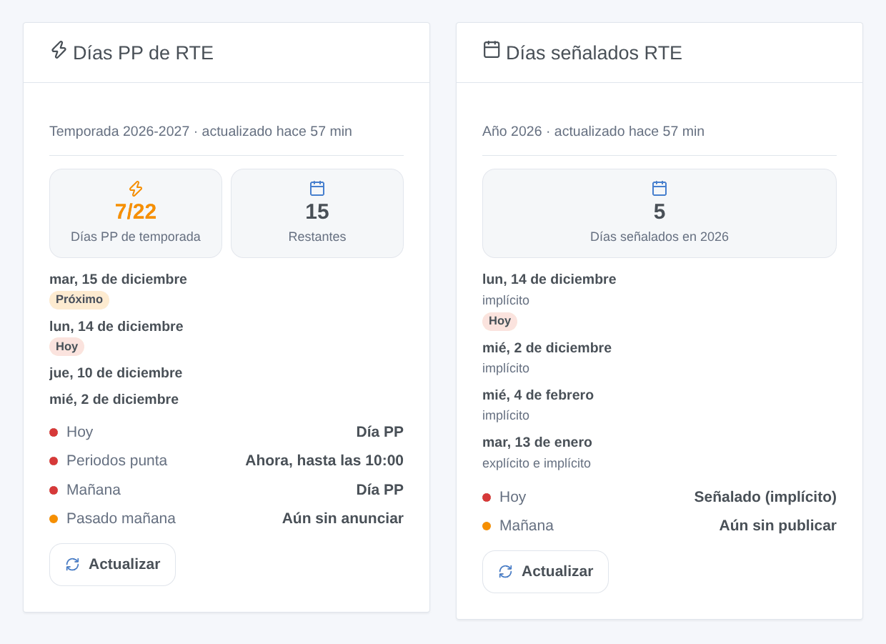

# RTE Jours signalés

## Presentación

Esta integración muestra en Gladys los días que RTE señala en la red eléctrica francesa:

- los **días PP** del mecanismo de capacidad (desde el 1 de noviembre de 2026): hasta 22 días por invierno, del 1 de noviembre al 31 de marzo, entre semana salvo festivos. Esos días, los **periodos punta** van de 7 a 10 h y de 17 a 20 h. RTE los anuncia la víspera a las 9:30, a veces dos días antes;
- los **días de deslastre** de la licitación de deslastre (explícito, implícito), publicados hacia las 11:00 para el día siguiente.

Algunos proveedores y agregadores recompensan el ahorro hecho esos días. Con los desencadenantes de escena, Gladys puede bajar la calefacción, apagar el termo o retrasar la carga del coche durante los periodos punta.

Los datos proceden de las API oficiales de RTE, gratuitas, con su propia aplicación. La integración solo lee RTE a las horas de publicación, pocas veces al día.

## Requisitos

- Gladys **5.3.0** o posterior.
- Una cuenta gratuita en [data.rte-france.com](https://data.rte-france.com).
- Una aplicación RTE suscrita a la API **Signal** (días PP), a la API **Demand Response Signal** (deslastre), o a ambas.

## Configuración

1. En [data.rte-france.com](https://data.rte-france.com), abra la API [Signal](https://data.rte-france.com/catalog/-/api/market/Signal/v2.0) y haga clic en **Subscribe to API**. Cree una aplicación (tipo Web / Server).
2. Haga lo mismo con la API [Demand Response Signal](https://data.rte-france.com/catalog/-/api/market/Demand-Response-Signal/v2.0), vinculándola a la **misma aplicación**.
3. En **My applications**, copie el **ID de cliente** y el **secreto** de la aplicación en la configuración de la integración.
4. Haga clic en **Probar la conexión**: el mensaje indica el estado de cada API y si hoy y mañana son días PP.

| Campo                                    | Función                                                                               |
| ---------------------------------------- | ------------------------------------------------------------------------------------- |
| ID de cliente                            | El ID de cliente de su aplicación RTE                                                 |
| Secreto de cliente                       | El secreto de la aplicación, nunca se vuelve a mostrar ni se escribe en los registros |
| Idioma de los textos de los dispositivos | Nombres de los dispositivos y funciones; automático: el del panel                     |

## Uso

### Dispositivos

En **Descubrimiento**, añada los dispositivos ofrecidos (uno por API a la que esté suscrita la aplicación).

**Días PP de RTE**: hoy, mañana, pasado mañana, periodo punta en curso, días PP de la temporada y restantes. **Días de deslastre de RTE**: hoy, mañana y días señalados del año.

| Valor | Insignia   | Significado                                                             |
| ----- | ---------- | ----------------------------------------------------------------------- |
| 0     | Sin riesgo | Día normal, o no señalado                                               |
| 1     | Bajo       | Aún sin anunciar (un día laborable de la temporada, o aún sin publicar) |
| 3     | Alto       | Día PP, día señalado, o periodo punta en curso                          |

En una escena, compare estos valores: «Día PP mañana» igual a 3, «Periodo punta en curso» igual a 3.

### Widgets del panel

- **Días PP de RTE**: hoy, mañana, pasado mañana, periodos punta, días PP de la temporada de 22, últimos días PP, botón **Actualizar**.
- **Días señalados RTE**: hoy y mañana con el tipo, días señalados del año, botón **Actualizar**.

### Escenas

Desencadenantes:

- **Se anuncia un día PP**: filtro hoy, mañana o pasado mañana. Variables: día, días hasta entonces, días PP de la temporada y restantes.
- **Empieza** / **termina un periodo punta**: a las 7:00 y 17:00, a las 10:00 y 20:00 de un día PP; filtro mañana o tarde.
- **Se señala un día de deslastre**: filtros día y tipo (explícito, implícito).

Cada día se desencadena una sola vez, incluso si la integración se reinicia.

Ejemplos:

- Cuando se anuncia un día PP para mañana → notificar «Mañana día PP».
- Cuando empieza un periodo punta → bajar los radiadores y apagar el termo; cuando termina → restablecerlo todo.
- Cuando se señala un día de deslastre implícito → retrasar la carga del coche después de las 20 h.

### Transporte

Nube: la integración lee las API de RTE por HTTPS con su ID de cliente y su secreto. No se envía nada sobre su casa. Los días se cuentan en hora francesa.

## Solución de problemas

- **«Credenciales rechazadas»**: copie de nuevo el ID de cliente y el secreto desde «My applications» en data.rte-france.com.
- **«API sin suscripción»**: la aplicación no está suscrita a esa API. Suscríbala desde la página de la API y haga clic en **Probar la conexión** (si no, la integración lo reintenta cada 6 horas).
- **Un solo dispositivo en el Descubrimiento**: normal si la aplicación solo está suscrita a una API.
- **«Aún sin anunciar» a las 9:00**: RTE anuncia los días PP hacia las 9:30; la integración lee a las 9:45 y luego cada 30 minutos mientras mañana sea desconocido.
- **Fuera de temporada (abril a octubre)**: no es posible ningún día PP, los valores se quedan en 0.
- Para informar de un problema, abra una issue en [GitHub](https://github.com/William-De71/gladys-rte-jours-signales/issues) con las versiones de Gladys y de la integración y el resultado de «Probar la conexión».
