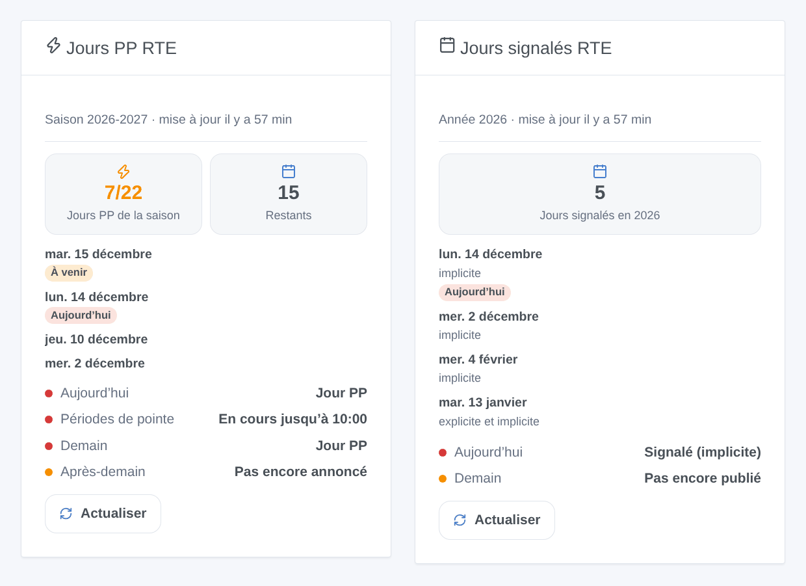

# RTE Jours signalés

## Présentation

Cette intégration affiche dans Gladys les jours que RTE signale sur le réseau électrique français :

- les **jours PP** du mécanisme de capacité (à partir du 1er novembre 2026) : jusqu’à 22 jours par hiver, du 1er novembre au 31 mars, en semaine hors jours fériés. Ces jours-là, les **périodes de pointe** vont de 7 h à 10 h et de 17 h à 20 h. RTE les annonce la veille à 9 h 30, parfois dès l’avant-veille ;
- les **jours signalés effacement** de l’appel d’offres effacement (explicite, implicite), publiés vers 11 h pour le lendemain.

Certains fournisseurs et agrégateurs récompensent les économies faites ces jours-là. Avec les déclencheurs de scène, Gladys peut baisser le chauffage, couper le chauffe-eau ou décaler la recharge de la voiture pendant les périodes de pointe.

Les données viennent des API officielles de RTE, gratuites, avec votre propre application. L’intégration ne lit RTE qu’aux heures de publication, quelques fois par jour.

## Prérequis

- Gladys **5.3.0** ou plus récent.
- Un compte gratuit sur [data.rte-france.com](https://data.rte-france.com).
- Une application RTE abonnée à l’API **Signal** (jours PP), à l’API **Demand Response Signal** (effacement), ou aux deux.

## Configuration

1. Sur [data.rte-france.com](https://data.rte-france.com), ouvrez l’API [Signal](https://data.rte-france.com/catalog/-/api/market/Signal/v2.0) et cliquez sur **Abonnez-vous à l’API**. Créez une application (type Web / Serveur).
2. Faites de même pour l’API [Demand Response Signal](https://data.rte-france.com/catalog/-/api/market/Demand-Response-Signal/v2.0), en la rattachant à la **même application**.
3. Dans **Mes applications**, copiez l’**ID client** et l’**ID secret** de l’application dans la configuration de l’intégration.
4. Cliquez sur **Tester la connexion** : le message indique l’état de chaque API, et si aujourd’hui et demain sont des jours PP.

| Champ                           | Rôle                                                                           |
| ------------------------------- | ------------------------------------------------------------------------------ |
| ID client                       | L’ID client de votre application RTE                                           |
| ID secret                       | Le secret de l’application, jamais réaffiché ni écrit dans les journaux        |
| Langue des textes des appareils | Noms des appareils et fonctionnalités ; automatique : celle du tableau de bord |

## Utilisation

### Appareils

Dans **Découverte**, ajoutez les appareils proposés (un par API à laquelle l’application est abonnée).

**Jours PP RTE** : aujourd’hui, demain, après-demain, période de pointe en cours, jours PP de la saison et restants. **Jours signalés effacement RTE** : aujourd’hui, demain et jours signalés de l’année.

| Valeur | Badge         | Signification                                                         |
| ------ | ------------- | --------------------------------------------------------------------- |
| 0      | Pas de risque | Jour normal, ou non signalé                                           |
| 1      | Faible        | Pas encore annoncé (un jour ouvré de la saison, ou pas encore publié) |
| 3      | Élevé         | Jour PP, jour signalé, ou période de pointe en cours                  |

Dans une scène, comparez ces valeurs : « Jour PP demain » égal à 3, « Période de pointe en cours » égal à 3.

### Widgets du tableau de bord

- **Jours PP RTE** : aujourd’hui, demain, après-demain, périodes de pointe, jours PP de la saison sur 22, derniers jours PP, bouton **Actualiser**.
- **Jours signalés RTE** : aujourd’hui et demain avec le type, jours signalés de l’année, bouton **Actualiser**.

### Scènes

Déclencheurs :

- **Un jour PP est annoncé** : filtre aujourd’hui, demain ou après-demain. Variables : jour, jours d’ici là, jours PP de la saison et restants.
- **Une période de pointe commence** / **se termine** : à 7 h et 17 h, à 10 h et 20 h d’un jour PP ; filtre matin ou soir.
- **Un jour signalé effacement est publié** : filtres jour et type (explicite, implicite).

Chaque jour ne déclenche qu’une fois, même si l’intégration redémarre.

Exemples :

- Quand un jour PP est annoncé pour demain → notifier « Demain jour PP ».
- Quand une période de pointe commence → baisser les radiateurs et couper le chauffe-eau ; quand elle se termine → tout remettre.
- Quand un jour signalé effacement implicite est publié → décaler la recharge de la voiture après 20 h.

### Transport

Cloud : l’intégration lit les API RTE en HTTPS avec votre ID client et votre ID secret. Rien sur votre maison n’est envoyé. Les jours sont comptés en heure française.

## Dépannage

- **« Identifiants refusés »** : recopiez l’ID client et l’ID secret depuis « Mes applications » sur data.rte-france.com.
- **« API non souscrite »** : l’application n’est pas abonnée à cette API. Abonnez-la depuis la page de l’API, puis cliquez sur **Tester la connexion** (sinon l’intégration réessaie toutes les 6 heures).
- **Un seul appareil dans la Découverte** : normal si l’application n’est abonnée qu’à une API.
- **« Pas encore annoncé » à 9 h** : RTE annonce les jours PP vers 9 h 30 ; l’intégration lit à 9 h 45, puis toutes les 30 minutes tant que demain reste inconnu.
- **Hors saison (avril à octobre)** : aucun jour PP possible, les valeurs restent à 0.
- Pour signaler un problème, ouvrez une issue sur [GitHub](https://github.com/William-De71/gladys-rte-jours-signales/issues) avec les versions de Gladys et de l’intégration et le résultat de « Tester la connexion ».
